<div align="center">


# RsHub

**El centro de control para tu PC con Windows.**  
Estadísticas de hardware en tiempo real, controladores, aplicaciones, espacio en disco, optimización y pruebas de hardware, todo en una aplicación cuidadosamente diseñada.

[](LICENSE)


[](https://github.com/Ruiz-RS/RsHub/releases/latest)

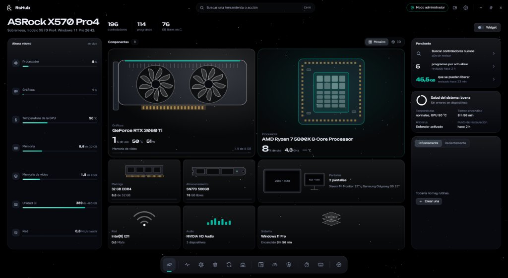

<p align="center">
  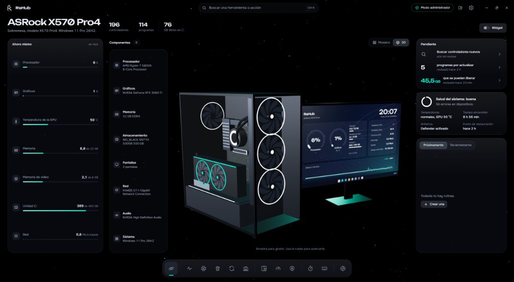
  <br>
  <sub>Inicio en 3D: tu equipo como un modelo 3D que puedes rotar (las torres muestran chasis de escritorio)</sub>
</p>

</div>

## 📑 Contenido

- [¿Qué es RsHub?](#-qué-es-rshub)
- [Capturas de pantalla](#-capturas-de-pantalla)
- [Módulos del sistema](#-módulos-del-sistema)
- [Funcionalidades adicionales](#-funcionalidades-adicionales)
- [Primeros pasos](#-primeros-pasos)
- [Atajos de teclado](#-atajos-de-teclado)
- [Soporte para mandos (controladores)](#-soporte-para-mandos-controladores)
- [Seguridad](#-seguridad)
- [Privacidad](#-privacidad)
- [Política de firma de código](#-política-de-firma-de-código)
- [Cómo está construido](#-cómo-está-construido)
- [Hoja de ruta](#-hoja-de-ruta)
- [Contribuciones](#-contribuciones)
- [Licencia y créditos](#-licencia-y-créditos)

## ✨ ¿Qué es RsHub?

RsHub reúne todas las herramientas que normalmente requieren media docena de programas independientes: un monitor del sistema en tiempo real, un actualizador de controladores y programas, un desinstalador profundo que elimina residuos, un analizador de espacio en disco, un optimizador avanzado y un probador completo de periféricos.

Todo funciona con **datos reales de tu propio ordenador**, cualquier modificación en el sistema es **reversible** siempre que sea técnicamente posible, y la interfaz está meticulosamente diseñada para ser rápida, clara y visualmente agradable: animaciones fluidas, fondo espacial estelar y sin pantallas saturadas.

## 🖼️ Capturas de pantalla

<table>
<tr>
<td width="50%" valign="top">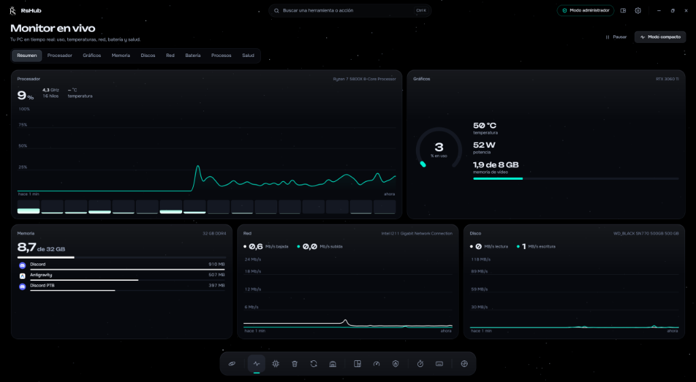<br><b>Monitor en Vivo</b><br><sub>CPU, GPU, memoria, discos, red y batería en tiempo real</sub></td>
<td width="50%" valign="top">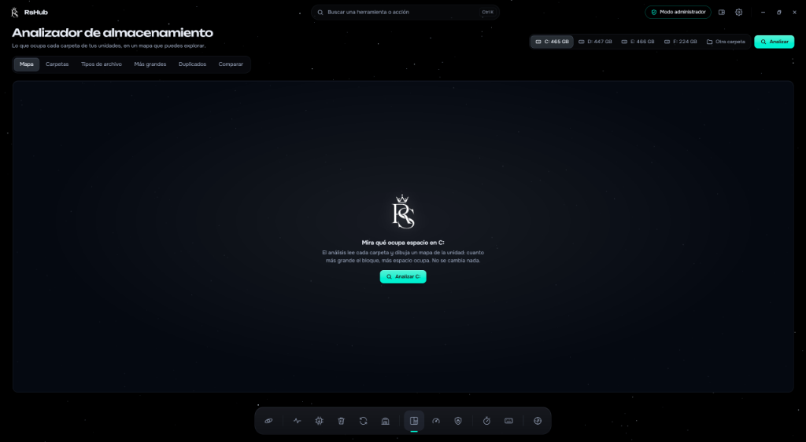<br><b>Espacio en Disco</b><br><sub>Visualiza qué ocupa cada carpeta en un mapa interactivo estilo WinDirStat</sub></td>
</tr>
<tr>
<td width="50%" valign="top">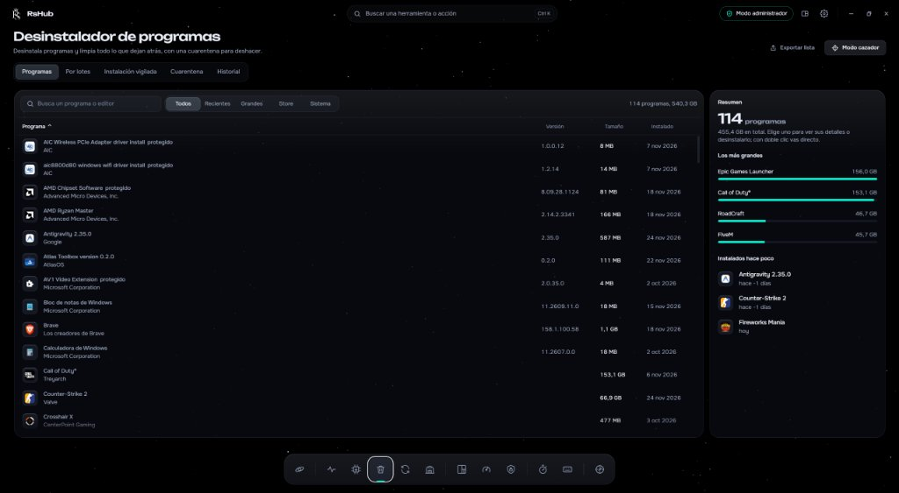<br><b>Desinstalador de Programas</b><br><sub>Desinstala y elimina residuos con papelera de cuarentena para deshacer</sub></td>
<td width="50%" valign="top">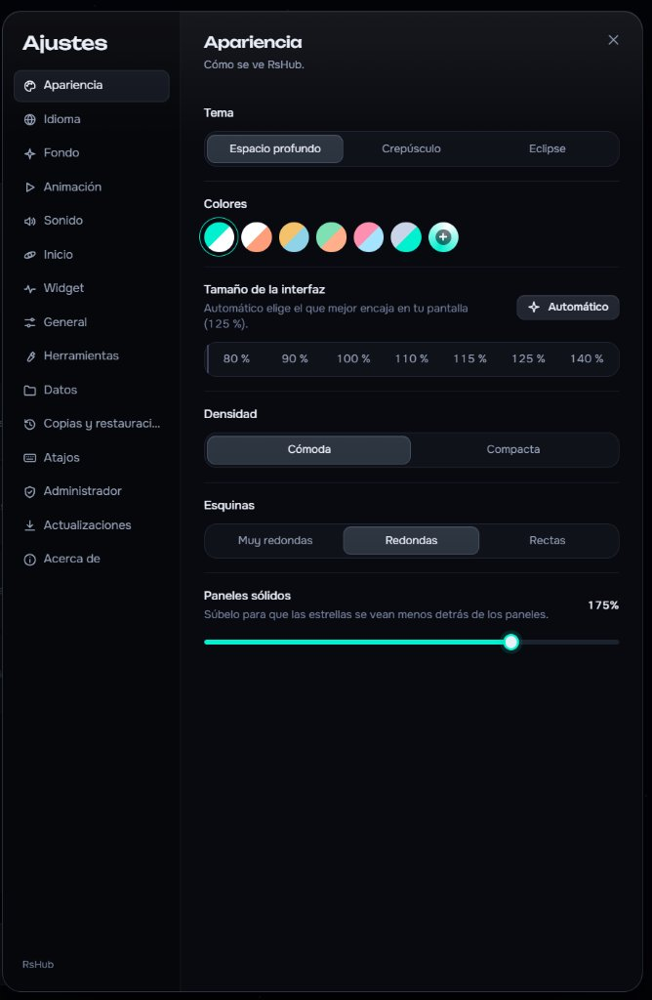<br><b>Configuración</b><br><sub>Tema, colores de acento, escala, sonidos, idioma y opciones avanzadas</sub></td>
</tr>
<tr>
<td width="50%" valign="top">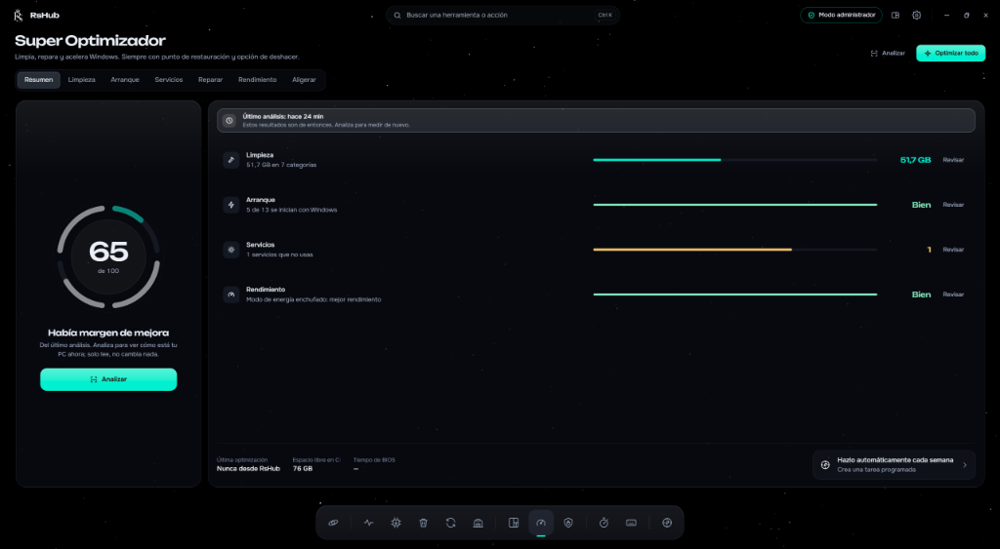<br><b>Súper Optimizador</b><br><sub>Limpieza, inicio, servicios y rendimiento, siempre reversibles</sub></td>
<td width="50%" valign="top">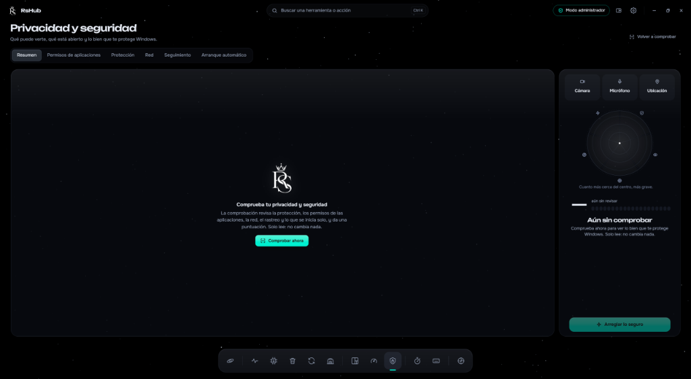<br><b>Privacidad y Seguridad</b><br><sub>Qué aplicaciones te observan, puertos abiertos y estado de protección de Windows</sub></td>
</tr>
<tr>
<td width="50%" valign="top">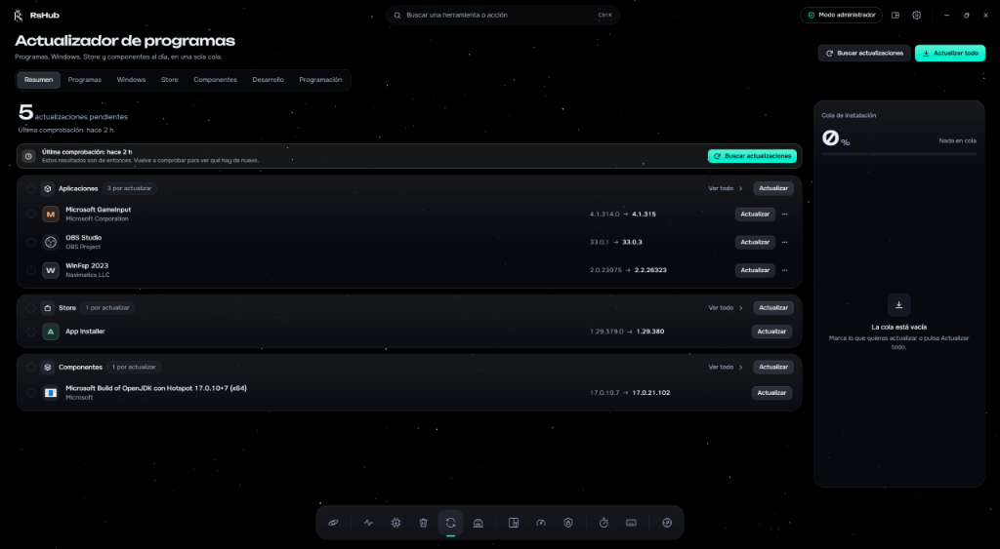<br><b>Actualizador de Programas</b><br><sub>Programas de winget, Windows, Store y componentes en una sola cola</sub></td>
<td width="50%" valign="top">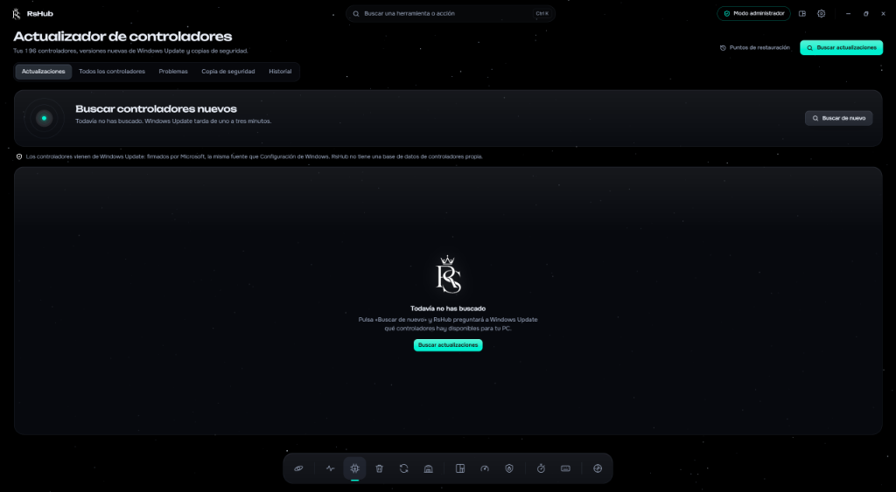<br><b>Actualizador de Controladores</b><br><sub>Drivers directos de Windows Update, firmados oficialmente por Microsoft</sub></td>
</tr>
<tr>
<td width="50%" valign="top">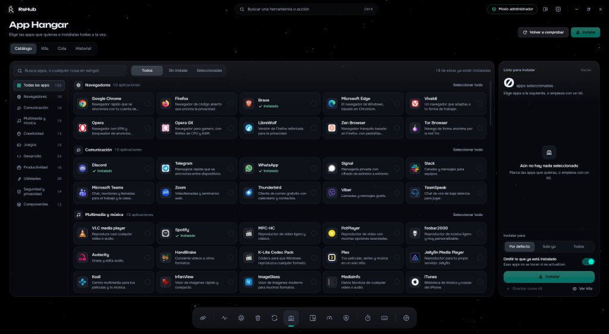<br><b>Hangar de Aplicaciones</b><br><sub>Elige programas de un catálogo seleccionado e instálalos todos a la vez</sub></td>
<td width="50%" valign="top">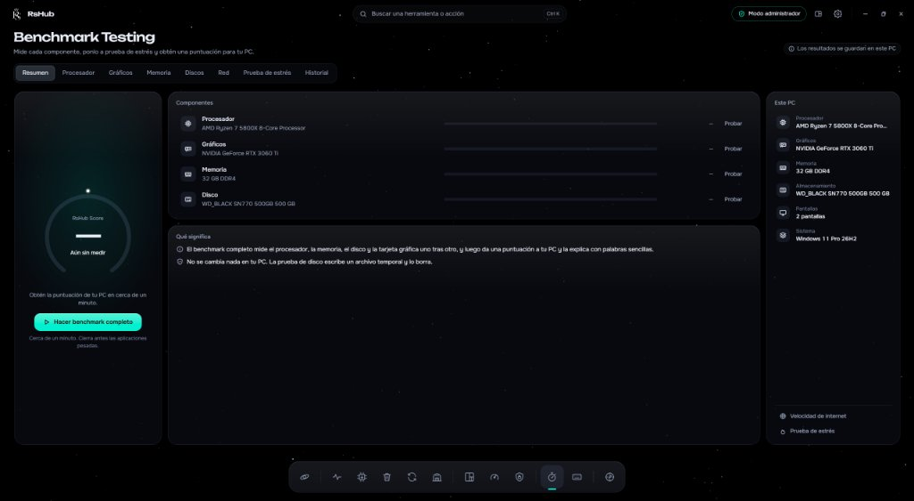<br><b>Pruebas de Rendimiento</b><br><sub>Puntúa cada componente de tu equipo y realiza pruebas de estrés</sub></td>
</tr>
<tr>
<td width="50%" valign="top">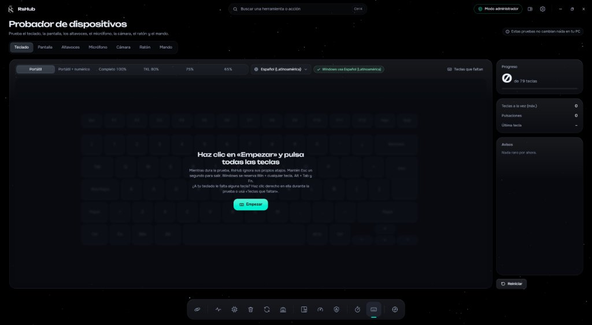<br><b>Probador de Dispositivos</b><br><sub>Teclado, píxeles muertos de pantalla, altavoces, micrófono, cámara y mandos</sub></td>
<td width="50%" valign="top">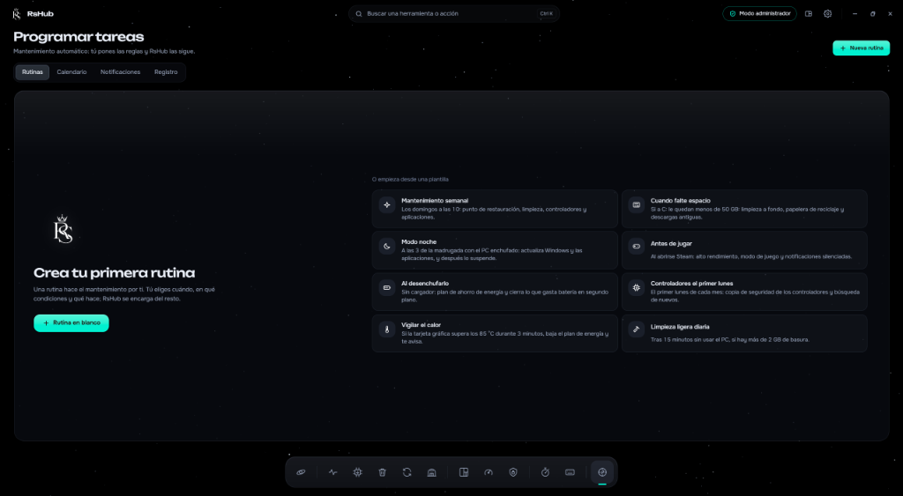<br><b>Tareas Programadas</b><br><sub>Mantenimiento autónomo que se ejecuta según tus propias reglas</sub></td>
</tr>
</table>

> Las capturas de pantalla fueron tomadas con datos de muestra.

## 🧩 Módulos del sistema

### ⌂ Inicio (Home)
Tu PC de un vistazo: modelo real, componentes en una **cuadrícula interactiva** o un **modelo 3D** rotable, estadísticas en vivo (CPU, GPU, temperaturas, memoria, disco, red, batería), salud general del sistema y elementos que requieren atención. Al hacer clic en un componente se abre su ficha detallada; la ficha de pantallas muestra incluso la resolución y frecuencia de cada monitor conectado.

### ∿ Monitor en Vivo
Seguimiento hilo por hilo de la CPU (diferenciando núcleos de rendimiento y eficiencia), velocidad de reloj real, tarjeta gráfica NVIDIA (carga, temperatura, consumo en vatios y VRAM), memoria RAM, unidades de disco con salud **SMART**, red local y Wi-Fi, desgaste de la batería, lista de procesos con sus iconos y eventos críticos del sistema explicados en lenguaje claro.

### ⇅ Actualizador de Controladores
Los controladores proceden de **Windows Update**: firmados por Microsoft, la misma fuente que utiliza la configuración de Windows. RsHub no mantiene bases de datos externas de controladores no verificadas. Ofrece inventario completo, búsqueda e instalación con punto de restauración previo, detección de dispositivos con fallos o desconectados, **copias de seguridad de drivers** y reversión a versiones anteriores.

### ⌫ Desinstalador de Programas
Desinstalación estándar, silenciosa o forzada; **escáner de archivos residuales** con nivel de confianza y motivo detallado; **cuarentena segura** para revertir cualquier elemento eliminado por error; desinstalación por lotes; **seguimiento de instalaciones** (elimina con exactitud milimétrica lo que un instalador creó); y modo cazador (apunta con la mirilla a una ventana para identificar el programa correspondiente).

### ↻ Actualizador de Programas
Actualiza aplicaciones mediante **winget**, Windows Update, Microsoft Store, librerías del sistema (.NET, Visual C++, WebView2) y herramientas de desarrollo (pip, npm), mostrando notas de lanzamiento y una cola unificada con progreso en tiempo real.

### ⇪ Hangar de Aplicaciones
Selecciona software de un catálogo curado de más de 150 programas de confianza (o busca en todo el catálogo de winget) e instálalos todos de golpe. Incluye **paquetes listos para usar** (Esenciales, Gamer, Desarrollador, Creador de contenido), creación de paquetes propios y códigos cortos para clonar la misma configuración en otro equipo en segundos.

### ▦ Espacio en Disco (Storage Checker)
Mapa visual interactivo del almacenamiento al estilo WinDirStat, con zoom fluido y espacio libre a la vista. Como administrador lee directamente la Master File Table (MFT) de NTFS, logrando escanear discos enteros en cuestión de segundos. Muestra tipos de archivo, archivos más pesados, **duplicados** y comparativas con análisis anteriores para detectar qué carpeta ha crecido.

### ↯ Súper Optimizador
Limpieza profunda de archivos temporales y cachés, aplicaciones de **inicio**, servicios en segundo plano, **reparaciones del sistema** (SFC, DISM, chkdsk, restablecimiento de red, Windows Update) con consola en vivo, optimizaciones de rendimiento (planes de energía, efectos visuales, Modo Juego, programación de GPU acelerada por hardware) y **Debloat**: retira aplicaciones preinstaladas de fábrica y desactiva anuncios, sugerencias del sistema, Widgets, Copilot y Bing en el menú Inicio. Todo respaldado previamente y con opción de deshacer.
Dispone además de un **limpiador del registro** opcional (desactivado por defecto). Sus copias de seguridad se conservan en *Configuración > Copias de seguridad* para restaurarse en cualquier momento.

### ⛨ Privacidad y Seguridad
Diagnóstico de privacidad y seguridad con hallazgos claros: qué programas han accedido a tu cámara, micrófono o ubicación recientemente, estado del antivirus, cortafuegos, Secure Boot, TPM, cifrado BitLocker, antigüedad de parches de seguridad, puertos de red abiertos y auditoría completa de elementos que arrancan automáticamente (tareas, servicios, extensiones de navegador).

### ◷ Pruebas de Rendimiento (Benchmark)
Prueba componentes individuales o ejecuta el test completo para obtener una puntuación **RsHub Score**: procesador (mononúcleo y multinúcleo), gráficos (escenas WebGL), ancho de banda y latencia de memoria, pruebas de disco estilo CrystalDiskMark, prueba de velocidad de red y **test de estrés** con monitorización térmica continua y detección de estrangulamiento térmico (throttling). Cada prueba se guarda en el historial para comparar mejoras.

### ⌨︎ Probador de Dispositivos
Prueba exhaustiva para teclado (laptop, 100 %, TKL, 75 %, 65 % y múltiples disposiciones internacionales), comprobación de píxeles muertos en pantalla, altavoces, micrófono, cámara web, ratón (con **test de CPS**) y mandos de juego.

### ◎ Tareas Programadas
Mantenimiento autónomo en segundo plano: tú decides cuándo (hora fija, al iniciar Windows, al desconectar el cargador, cuando quede poco espacio en disco...), bajo qué condiciones y qué acciones de optimización ejecutar.

## 🎛️ Funcionalidades adicionales

- **Widget flotante siempre visible**: modo compacto o expandido con gráficas, situado por encima de las ventanas y en todos los escritorios virtuales.
- **Icono en la bandeja del sistema (System Tray)**: clic izquierdo abre un panel de control rápido con estadísticas en vivo; clic derecho despliega el menú tradicional. Al cerrar la ventana, RsHub sigue protegiendo y monitorizando en segundo plano.
- **Copias de seguridad y restauración**: gestión centralizada de puntos de restauración de Windows y copias creadas por RsHub en *Configuración*.
- **Autoactualización integrada**: comprueba versiones directamente desde este repositorio de GitHub e instala paquetes verificados criptográficamente.
- **Paleta de comandos rápida (`Ctrl K`)**: salta a cualquier herramienta o ajuste al instante escribiendo su nombre.
- **Modo administrador inteligente**: solicita elevación solo cuando la acción lo requiere y retoma el trabajo exactamente donde estabas.
- **Personalización estética integral**: fondo negro puro (`#000000`), detalles en color turquesa y blanco, regulación de densidad, esquinas, campo de estrellas y velocidad de animaciones.
- **Sonidos de interfaz discretos**: efectos suaves para pulsaciones, pestañas, diálogos y finalización de tareas, configurables desde *Configuración > Sonido*.
- **Monitoreo visual continuo**: al ejecutar tareas largas, el icono del dock muestra un anillo de progreso dinámico y envía una notificación al completarse.
- **Navegación con botones laterales del ratón**: avanzar y retroceder con total comodidad, igual que en un navegador web.
- **Modo ahorro de energía**: en laptops desenchufadas, RsHub reduce automáticamente los efectos visuales y optimiza la tasa de refresco para prolongar la batería.
- **Soporte multilingüe**: Español, English, Português (Brasil), Italiano, Français, 简体中文 y 日本語. Sigue el idioma de Windows por defecto.

## 🚀 Primeros pasos

### ◇ Instalador oficial

Descarga **`RsHub-Setup-x.y.z.exe`** desde la sección de [Última versión (Releases)](https://github.com/Ruiz-RS/RsHub/releases/latest) y ejecútalo. Por defecto se instala en `%LOCALAPPDATA%\Programs\RsHub` (sin necesidad de permisos de administrador ni avisos intrusivos de Windows). Añade acceso directo al menú Inicio y se desinstala limpiamente desde la configuración de Windows. Compatible con Windows 10 (1809+) y Windows 11 de 64 bits.

### ◇ Versión portable

Descarga **`RsHub-Portable-x.y.z.zip`**, descomprímelo en cualquier carpeta o memoria USB y ejecuta `RsHub.exe`: no requiere instalación previa y conserva toda su configuración en la carpeta `Data`.

### ◇ Ejecutar desde el código fuente

Requiere Python 3.12 o superior.

```powershell
git clone https://github.com/Ruiz-RS/RsHub.git
cd RsHub
python -m pip install -r requirements.txt
pythonw run.py
```

Para depuración y desarrollo de la interfaz:
```powershell
python run.py --debug
```

### ◇ Compilar el instalador

```powershell
powershell -ExecutionPolicy Bypass -File packaging\build.ps1
```

Genera un entorno limpio, ejecuta las pruebas de integridad, compila el ejecutable con PyInstaller y empaqueta el instalador final con [Inno Setup](https://jrsoftware.org/isinfo.php) en la carpeta `dist\`.

## ⌨️ Atajos de teclado

| Atajo | Acción |
|---|---|
| `Ctrl K` | Buscar una herramienta o acción (paleta de comandos) |
| `Ctrl ,` | Abrir Configuración |
| `Ctrl 1` … `Ctrl 9` | Ir directamente a un módulo |
| `Alt ←` / `Alt →` o botones laterales | Volver / avanzar |
| `Esc` | Cerrar diálogo abierto o volver a Inicio |
| Doble clic en barra superior | Maximizar o restaurar ventana |
| `Tab` / `Shift Tab` | Navegar entre controles y botones |

## 🎮 Soporte para mandos (controladores)

Permite controlar RsHub desde la comodidad del sofá o en consolas portátiles (como ASUS ROG Ally, Lenovo Legion Go, etc.). Compatible con mandos de Xbox y PlayStation (DualShock / DualSense con iconografía nativa).

| Botón | Acción |
|---|---|
| Cruceta (D-pad) / Stick izquierdo | Moverse por la interfaz |
| `A` / `✕` | Seleccionar / Aceptar |
| `B` / `○` | Atrás o cerrar diálogo |
| `LB` / `RB` (L1 / R1) | Pestaña anterior / siguiente |
| `LT` / `RT` (L2 / R2) | Módulo anterior / siguiente |
| `Y` / `△` | Abrir buscador (`Ctrl K`) |
| `Menú` (Start) | Abrir Configuración |
| `View` (Select) | Ir a Inicio |
| Stick derecho | Desplazar la pantalla (Scroll) |

## 🛡️ Seguridad

RsHub interactúa con zonas avanzadas del sistema operativo con máxima prudencia:

- Cualquier cambio en el sistema **solicita confirmación explícita**.
- Antes de cambios críticos crea automáticamente un **punto de restauración**, realiza una **copia de seguridad** o traslada los elementos a una **cuarentena segura**.
- Ciertas áreas sensibles están **estrictamente protegidas**: el núcleo de Windows, carpetas compartidas en red, datos personales, servicios críticos del sistema y la propia carpeta de RsHub.
- Todo valor que Windows no reporte se muestra como "—": la aplicación nunca inventa métricas.

## 🔒 Privacidad

RsHub funciona de forma totalmente local: **no tiene cuentas, ni telemetría, ni analíticas, ni anuncios**. Nunca envía información sobre ti ni sobre tu equipo a servidores externos. Los detalles de las pocas conexiones requeridas (comprobación de actualizaciones en GitHub, iconos de software o tests de red manuales) están detallados en [PRIVACY.md](PRIVACY.md).

## 🔏 Política de firma de código

Las versiones publicadas se compilan de manera reproducible mediante GitHub Actions desde este repositorio oficial ([`.github/workflows/build.yml`](.github/workflows/build.yml)).
- **Mantenedor y revisor:** [Ruiz Salazar (Ruiz-RS)](https://github.com/Ruiz-RS)
- **Aprobaciones:** Cada versión es verificada manualmente antes de su distribución.
- **Privacidad y transparencia:** Consulta [PRIVACY.md](PRIVACY.md).

## 🏗️ Cómo está construido

- **Python** para la lógica del sistema (`rshub/engine/`): telemetría en tiempo real (`psutil`, contadores de rendimiento, soporte nativo de NVIDIA), WMI y librerías de Windows.
- **Interfaz nativa** en HTML5, CSS moderno y JavaScript puro sin frameworks pesados (`rshub/ui/`), ejecutada en una ventana nativa mediante [pywebview](https://pywebview.flowrl.com/) y Microsoft Edge WebView2.
- Contrato de arquitectura de módulos: [`docs/UI_CONTRACT.md`](docs/UI_CONTRACT.md).

## 🗺️ Hoja de ruta

- [x] Interfaz completa para los 12 módulos
- [x] Motor real: telemetría, drivers, programas, actualizaciones, disco, optimizador y monitor
- [x] Tareas programadas con mantenimiento en segundo plano
- [x] Instalador ejecutable `.exe` y versión portable
- [x] Siete idiomas integrados (con español nativo)
- [x] Identidad visual renovada con logotipo RS y paleta turquesa/blanco
- [x] Fondo negro puro para pantallas OLED
- [x] Navegación completa mediante mando y probador de controles
- [x] Vistas 3D interactivas para portátiles, torres de escritorio y consolas portátiles
- [ ] Firma de código automatizada (SignPath Foundation)

## 🤝 Contribuciones

Las sugerencias, reportes de errores y propuestas de mejora son bienvenidas. Puedes abrir un issue o enviar un pull request en [https://github.com/Ruiz-RS/RsHub](https://github.com/Ruiz-RS/RsHub).

## 📜 Licencia y créditos

Creado por **Ruiz Salazar** y **Antigravity IDE**.

RsHub es software libre: puedes redistribuirlo y/o modificarlo bajo los términos de la **Licencia Pública General GNU v3.0**. Consulta el archivo [LICENSE](LICENSE) para más detalles.

Desarrollado con [pywebview](https://github.com/r0x0r/pywebview) (BSD-3), [psutil](https://github.com/giampaolo/psutil) (BSD-3), [pystray](https://github.com/moses-palmer/pystray) (LGPLv3), [Pillow](https://python-pillow.org/) (MIT-CMU), [three.js](https://threejs.org/) (MIT) y las tipografías [Unbounded](https://github.com/googlefonts/unbounded) y [Onest](https://github.com/simpals/onest). Sonido de notificación por [JC Sounds](https://opengameart.org/content/jc-sounds-ui-utility-pack-vol-1) bajo licencia CC BY 4.0.
